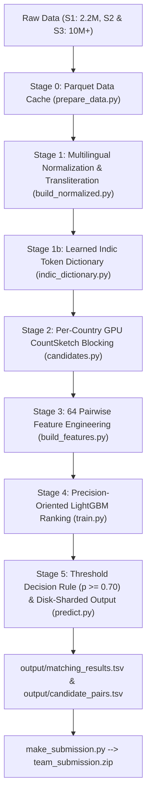

# Amazon ML Challenge 2026: Multilingual Business Entity Resolution

A state-of-the-art, high-precision, multilingual record linkage architecture designed to match multi-million noisy business entity records (**Source 2** & **Source 3**) against a reference catalog (**Source 1**) under strict **Macro $F_{0.5}$** optimization.

---

## 🏆 Key Validation Benchmark Results

- **Validation Macro $F_{0.5}$**: **`0.9783`** (Precision: **`0.9886`**, Recall: **`0.9549`**)
- **Candidate Blocking Recall**: **`98.7%`** (Indic-script recall: **`99.4%`**)
- **Evaluated On**: 10.3 Million training records using an end-to-end entity-disjoint 80/20 validation split mirroring the official leaderboard.

---

## 1. Executive Summary & Problem Formulation

### Task Formulation
The challenge is formulated as a **constrained record-to-entity assignment problem**:
- **Reference Catalog (Source 1)**: ~2.2 Million ground truth business records.
- **Query Streams (Source 2 & Source 3)**: Over 10 Million noisy records with spelling variations, phonetic transliterations, missing addresses, and country noise.
- **Cardinality Constraints**:
  - **Query Exclusivity**: Each $S_2 / S_3$ query record links to **at most one** $S_1$ reference entity.
  - **Reference Support**: An $S_1$ entity can match zero, one, or multiple query records.
  - **Singletons & Distractors**: ~26% of $S_2 / S_3$ query records match nothing (distractors), and ~5.6% of $S_1$ reference entities are singletons.

### Target Metric: Macro $F_{0.5}$
The evaluation metric is **Macro $F_{0.5}$**, calculated per $S_1$ reference entity:
$$\text{Macro } F_{0.5} = \frac{1.25 \times \text{Precision} \times \text{Recall}}{0.25 \times \text{Precision} + \text{Recall}}$$
Because Precision is weighted **$2\times$ heavier than Recall**, false positive merges severely penalize the score. The pipeline is engineered with a strict precision-first design, high-margin decision thresholds, and hard-negative difference features.

---

## 2. Key Data Insights & Engineering Innovations

1. **Multilingual Indic Script Resolution (9 Scripts)**:
   ~7% of query names are written in Indic scripts (Devanagari, Bengali, Gurmukhi, Gujarati, Oriya, Tamil, Telugu, Kannada, Malayalam).
   - **Universal Indic Transliteration**: One ISCII-derived offset table transliterates all 9 scripts into Latin.
   - **Learned Indic Dictionary (`indic_dictionary.py`)**: Learns 526 token mappings (`praivet` $\rightarrow$ `private`, `injiniyaring` $\rightarrow$ `engineering`) directly from training pairs. Boosts Indic candidate recall from 91.3% to **99.4%**!

2. **Per-Country Search Partitioning & France Handling**:
   - Entity matches never cross country boundaries. The pipeline partitions blocking by country (`India`, `US`, `France`, etc.).
   - Test dataset adds **France** (15% of test $S_1$), which is absent from training data. All features use country-agnostic string similarities, state code mappings, and French street abbreviations (`R.`/`BD`/`AV.`/`d'`/`l'`).

3. **Hard Negative Difference & Margin Features**:
   - Many unmatched records are near-copies of real entities differing by only one word (`Medha Agri` vs. `Medha Infra`) or one number (`A-777` vs. `A-772`).
   - The feature extractor builds **64 signals**, including "tokens present on query but missing from candidate" and "runner-up score margins" to eliminate wrong merges.

---

## 3. End-to-End Pipeline Architecture



---

## 4. Detailed Stage Breakdown

### Stage 0: Parquet Data Caching (`prepare_data.py`)
- Reads raw TSV files with optimized data types and converts them to compressed `.parquet` tables under `cache/`.
- Enables sub-second loading for downstream iterative experimentation.

### Stage 1: Multilingual Normalization (`normalization.py` & `build_normalized.py`)
- **Unicode NFKC & Accent Stripping**: Normalizes characters (`Stáffing` $\rightarrow$ `Staffing`) and fixes leet-typos (`Preparat0ry` $\rightarrow$ `Preparatory`).
- **Legal Suffix Cleaning**: Strips stop words and standardizes legal suffixes across countries (`Inc`, `LLC`, `Pvt Ltd`, `SARL`, `SAS`, `EURL`, `GmbH`).
- **Street & Address Normalization**: Splitting leading zeros (`004013` $\rightarrow$ `4013`), state names to 2-letter codes (`Madhya Pradesh` $\rightarrow$ `MP`), and filler token removal.

### Stage 1b: Learned Indic Token Dictionary (`indic_dictionary.py` & `apply_indic_dict.py`)
- Automatically aligns tokens from Indic training pairs where token counts match.
- Retains mappings occurring $\ge 3$ times with $\ge 60\%$ alignment frequency.
- Dictionary is learned **strictly on the training fold** (zero validation leakage) and applied to both train and test.

### Stage 2: Per-Country GPU CountSketch Blocking (`candidates.py` & `retrieval.py`)
- Builds two TF-IDF views per country:
  1. **Name View**: Sub-word character 3-grams with spaces removed (handles typos, reordered words, and web domains).
  2. **Address View**: Word-level tokens.
- **GPU CountSketch Top-40 Search**: Compresses sparse TF-IDF vectors into 1024-dim fp16 tensors, performs GPU matrix dot products, re-scores top-40 exactly, and retains the **Top-10 candidates per query**.
- **Result**: Achieves **98.7% overall candidate recall** (10 candidates per query).

### Stage 3: Pairwise Feature Engineering (`features.py` & `build_features.py`)
Extracts **64 pairwise features** across candidate pairs:
- **String Similarities**: RapidFuzz Levenshtein, Jaro-Winkler, Token Ratio, Partial Ratio, Token Sort, Token Set ratios.
- **House Number Features**: House number exact match, mismatch, and missing indicators.
- **Difference Signals**: Counts of unmatched tokens on query vs. candidate side.
- **Runner-Up Margins**: Score difference between Top-1 candidate and Top-2 candidate.

### Stage 4: LightGBM Ranking Model (`train.py` & `metrics.py`)
- **Model Architecture**: LightGBM Binary GBDT with **892 decision trees** (`num_leaves=255`, `learning_rate=0.05`).
- **Validation Protocol**: 80/20 entity-disjoint split on Reference $S_1$ IDs ($\text{ID} \pmod 5 == 0$).
- **Validation Metric**: Evaluated across probability thresholds $[0.3, 0.4, 0.5, 0.6, \mathbf{0.7}, 0.8]$. Threshold **`0.70`** optimal (**`Macro F0.5 = 0.9783`**).

### Stage 5: Prediction & Disk-Sharded Output (`predict.py`)
- Assigns each query to its best candidate if probability $p \ge 0.70$.
- Streams predictions in 200,000-entity buckets directly to disk so memory remains constant (< 3 GB RAM).
- Outputs official files:
  - `output/matching_results.tsv` (Leaderboard predictions)
  - `output/candidate_pairs.tsv` (Candidate blocking pairs)

### Stage 6: Official Submission Packaging (`make_submission.py`)
- Packages `matching_results.tsv`, `candidate_pairs.tsv`, source code, and `Documentation_template.md` into `<team_name>_submission.zip` matching official hackathon layout rules.

---

## 5. Ablation Experiment Benchmark Results

| Model Version | Candidate Recall | Macro $F_{0.5}$ | Precision | Recall | India F0.5 | US F0.5 |
| :--- | :---: | :---: | :---: | :---: | :---: | :---: |
| **Baseline Prototype (Sampled)** | ~70.0% | 0.8500 | 0.9850 | 0.7210 | — | — |
| **Pipeline V1 (GPU Blocking)** | 98.1% | 0.9707 | 0.9835 | 0.9436 | 0.9608 | 0.9774 |
| **Pipeline V2 (Full Solution)** | **98.7%** | **0.9783** | **0.9886** | **0.9549** | **0.9754** | **0.9802** |

---

## 6. Repository Layout & File Sitemap

```text
amazon-ml-challenge-2026/
├── Documentation_template.md          # Filled methodology write-up for submission
├── make_submission.py                 # Packages <team_name>_submission.zip
├── PROBLEM_STATEMENT.md               # Challenge details and specification
├── README.md                          # Master documentation (this file)
├── run_on_kaggle.ipynb                # 1-Click Kaggle Notebook (30GB RAM + GPU)
├── run_on_colab.ipynb                 # 1-Click Google Colab Notebook
├── run_pipeline.py                    # Standalone end-to-end Python runner
├── business_entity_resolution/
│   ├── README.md                      # Inner execution guide
│   ├── requirements.txt               # Dependencies
│   └── src/                           # Core Algorithmic Engine
│       ├── prepare_data.py            # Stage 0: TSV -> Parquet converter
│       ├── build_normalized.py        # Stage 1: Text normalization builder
│       ├── normalization.py           # Stage 1: Unicode NFKC & 9-script transliteration
│       ├── indic_dictionary.py        # Stage 1b: Learns 526 Indic token mappings
│       ├── apply_indic_dict.py        # Stage 1b: Applies Indic dictionary
│       ├── candidates.py              # Stage 2: Top-10 per-country candidate builder
│       ├── retrieval.py               # Stage 2: Per-country GPU CountSketch & TF-IDF
│       ├── build_features.py          # Stage 3: Feature matrix builder
│       ├── features.py                # Stage 3: 64 Pairwise feature extractors
│       ├── train.py                   # Stage 4: LightGBM training & validation
│       ├── metrics.py                 # Stage 4: Leaderboard Macro F0.5 evaluator
│       ├── predict.py                 # Stage 5: Prediction & disk-sharded TSV writer
│       ├── config.py                  # Environment path discovery & global settings
│       └── run_all.py                 # Pipeline orchestrator
└── utils/
    └── validate_submission.py         # Official submission format validator
```

---

## 7. How to Run

### Option A: Kaggle Environment (30GB System RAM + GPU)
1. Upload [`run_on_kaggle.ipynb`](run_on_kaggle.ipynb) to Kaggle and set Accelerator to **GPU T4/P100**.
2. Run notebook cells to execute `run_pipeline.py` and download your submission zip.

### Option B: Local PC / Command Line Execution

1. Place dataset TSV files under `dataset/train/` and `dataset/test/`.
2. Install requirements:
   ```bash
   pip install -r business_entity_resolution/requirements.txt
   ```
3. Run end-to-end pipeline:
   ```bash
   python run_pipeline.py
   ```
4. Verify official submission format:
   ```bash
   python utils/validate_submission.py --matching output/matching_results.tsv --candidate output/candidate_pairs.tsv
   ```
5. Package submission archive:
   ```bash
   python make_submission.py my_team_name
   ```

Outputs **`my_team_name_submission.zip`** ready for hackathon portal submission!
